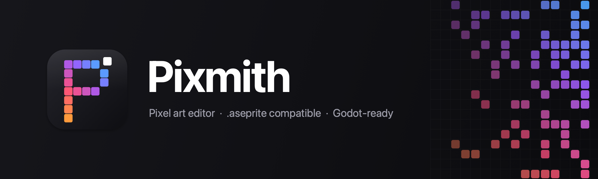
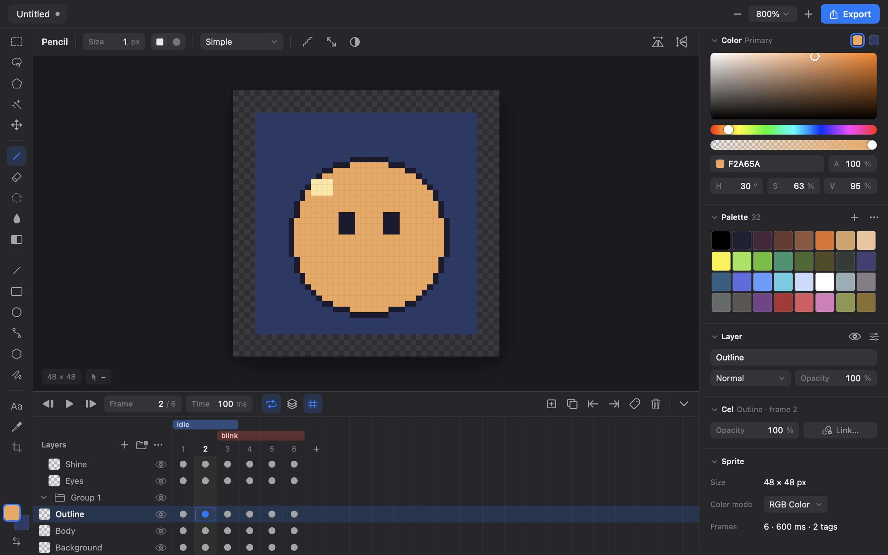
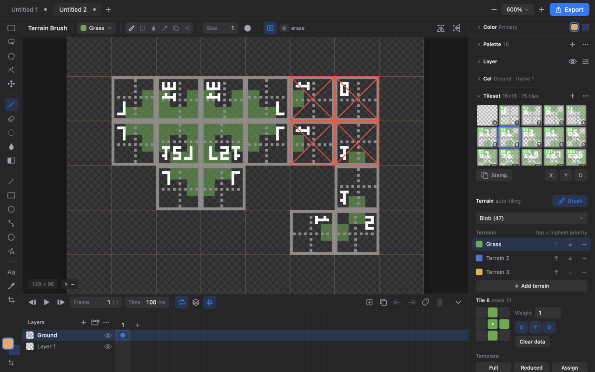
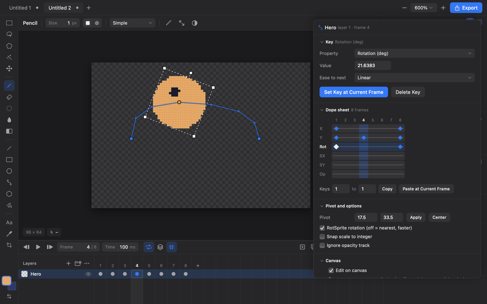
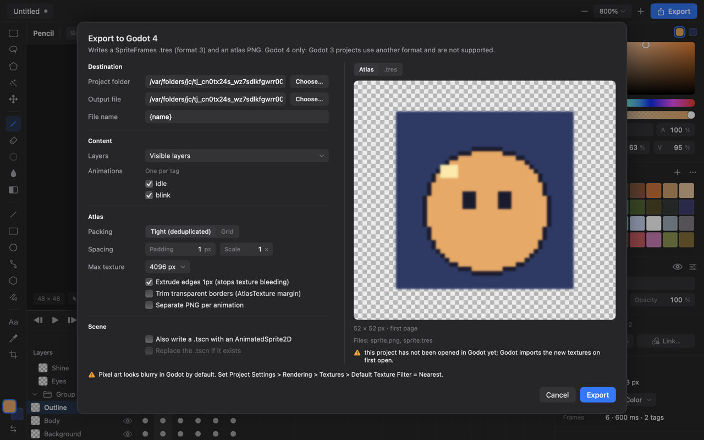

<picture>
  <source media="(prefers-color-scheme: light)" srcset="assets/banner-light.png">
  
</picture>

Pixmith is a lightweight pixel-art editor. It reads and writes the `.aseprite` file format, so sprites can move between Pixmith and other tools that speak it.

All editing lives in a platform-independent Rust core with a plain C ABI. Front ends are thin shells around it: a SwiftUI/AppKit app for macOS, a cross-platform egui app for Windows, Linux and macOS (`desktop/`), and a command-line tool, `pixmith-cli`, all on the same core. More front ends are welcome; see [CONTRIBUTING.md](CONTRIBUTING.md#adding-a-front-end-for-another-platform).

Pixmith is original code, written from the public `.aseprite` file format specification. It is not affiliated with Aseprite.

<p align="center">
  <picture>
    <source media="(prefers-color-scheme: light)" srcset="docs/design/screens/main-light@2x.png">
    
  </picture>
</p>

<table>
  <tr>
    <td width="33%"></td>
    <td width="33%"></td>
    <td width="33%"></td>
  </tr>
  <tr>
    <td align="center">Auto-tiling with terrains</td>
    <td align="center">Tweening with a dope sheet</td>
    <td align="center">One-click Godot 4 export</td>
  </tr>
</table>

## Download

Every build is on [Releases](https://github.com/azdharsyahputra/pixmith/releases):

| Platform | File | Notes |
| --- | --- | --- |
| macOS 13 or newer, Apple silicon | `Pixmith-<version>.dmg` | The native SwiftUI app. Open the disk image and drag Pixmith to Applications. |
| Windows 10 or newer, x64 | `Pixmith-Setup-<version>-x64.exe` | **Recommended.** The installer for the egui app: per-user by default (no administrator rights), or for all users. Adds a Start Menu entry, makes `.pxmt` open with Pixmith (and `.aseprite` if you tick it), and puts the `pixmith` command on your PATH. Upgrades in place; remove it in Settings → Apps. |
| Windows 10 or newer, x64 | `Pixmith-<version>-windows-x64.zip` | Portable: unzip anywhere and run `Pixmith.exe`; the `pixmith` command is `bin\pixmith.exe` (not on the PATH until you add that folder). |
| Linux, x64 | `Pixmith-<version>-linux-x64.tar.gz` | **Best effort.** The egui app, built and tested automatically in CI but not tried by hand on Linux desktops, and not packaged for any distribution. Needs OpenGL or Vulkan and X11 or Wayland. Unpack and run `./Pixmith`; the `pixmith` command is `bin/pixmith`. |

The Windows and Linux builds use the egui front end, which mirrors the macOS app (see [desktop/README.md](desktop/README.md) for the few differences).

The apps are not signed or notarized yet. On macOS, Gatekeeper blocks the first launch ("Apple could not verify Pixmith…"): click **Done**, open **System Settings → Privacy & Security**, click **Open Anyway** next to the Pixmith message and confirm. You only do this once. Or run:

```sh
xattr -dr com.apple.quarantine /Applications/Pixmith.app
```

On Windows, SmartScreen may warn about an unknown publisher (for the installer and for `Pixmith.exe`): choose More info, then Run anyway.

## Build and run

The core and `pixmith-cli` build anywhere Rust does (`cd core && cargo build --release`). The macOS app needs macOS 13 or newer and the Swift toolchain that ships with Xcode or the Command Line Tools. The egui desktop app builds on Windows, Linux and macOS with just Rust (`cd desktop && cargo run --release`; Linux needs a few system packages, listed in [desktop/README.md](desktop/README.md)).

```sh
./build.sh                  # builds core/ and app/, assembles build/Pixmith.app and build/pixmith-cli
open build/Pixmith.app

cd core && cargo test       # Rust unit and CLI integration tests
```

``.aseprite`, `.ase` and `.png` files can be opened from the Open panel, from Finder (Open With), or by dropping them on the Dock icon. WebP, JPEG, BMP, TGA, ICO, PCX and FLI/FLC files open the same way, as new unsaved sprites (an icon with several sizes asks which one). Animated GIFs and sprite sheets with JSON metadata are opened from File > Import.

### End-to-end tests

```sh
./scripts/qa.sh             # builds and runs every scenario headlessly (about 66 scenarios, several minutes)
./scripts/qa.sh tilemap/    # only the scenarios whose name contains "tilemap/"
app/.build/debug/pixmith-qa --list
```

`pixmith-qa` drives the real app code (the model, the canvas view's mouse and key handlers, modal dialogs, file actions and the SwiftUI window) in an offscreen window, so it needs no Accessibility or Screen Recording permission and shows nothing on screen. PNG snapshots of key states go to `qa-out/` (`PIXMITH_QA_OUT`). Each scenario runs in its own process with a temporary `HOME` and `PIXMITH_SUPPORT_DIR`, so nothing touches your real autosave or script folders.

Exit status, for CI: `0` every scenario passed; `1` at least one scenario failed, crashed or timed out (the failing checks are printed as `FAIL <scenario>: <what> (<file>:<line>)`); any other non-zero status means the Rust core or the runner failed to build. `PIXMITH_QA_TIMEOUT` sets the seconds allowed per scenario (default 180), `PIXMITH_QA_VERBOSE=1` prints scenario notes and `PIXMITH_JOBS` limits build parallelism.

### Packaging

```sh
./scripts/package.sh        # writes dist/Pixmith-<version>.dmg
```

The script builds a universal (arm64 + x86_64) app when the Rust toolchain has both macOS targets. With `rustup` it installs the missing target; without it, it builds the native architecture only and prints a warning. The disk image contains `Pixmith.app` (with the command line tool inside it) and an `Applications` shortcut. The app is signed ad-hoc unless you set:

| Variable | Effect |
| --- | --- |
| `PIXMITH_SIGN_IDENTITY` | `codesign` identity, e.g. `Developer ID Application: Name (TEAMID)`; enables the hardened runtime. |
| `PIXMITH_NOTARY_PROFILE` | `notarytool` keychain profile; submits the dmg and staples the ticket (needs `PIXMITH_SIGN_IDENTITY`). |
| `PIXMITH_JOBS` | Parallel jobs for cargo and swift. |

`./scripts/make-icon.sh` regenerates `assets/AppIcon.icns` from `scripts/make-icon.swift`.

## Features

**Drawing**
- Pencil (optional pixel-perfect mode), eraser, flood fill (contiguous or global), eyedropper, line, rectangle, ellipse, polygon, Bezier curve, freehand contour, spray, blur, jumble, gradient and text tools. Blur averages the pixels under the brush as you paint (with a strength option); Jumble swaps nearby pixels at random. Both use the brush size and shape, mirroring, the selection, and are one undo step per stroke. Shapes can be filled or outlined; Shift constrains lines, squares and circles.
- Square or round brushes of size 1-64, custom brushes captured from a selection, horizontal and vertical mirroring, pen pressure for size and opacity on tablets.
- Ink modes: Simple, Alpha Compositing, Lock Alpha, Behind and Shading (steps along the palette). The right mouse button draws with the secondary color.
- Text with a built-in 5x8 pixel font or a system font.

**Selection and editing**
- Rectangular marquee, magic wand, lasso and polygon lasso; hold Shift to add and Option to subtract; expand, contract, border, invert, select by color.
- Move, nudge, flip, rotate, cut, copy and paste (floating paste), crop to selection, canvas resize.
- Free Transform (Cmd-T): scale, rotate, skew and move with a live preview, including a RotSprite-style resampler.
- Undo and redo that store only the pixels a step changed (up to 1 GiB of history per document; one step takes well under a millisecond on a 4096 x 4096 canvas), and a History panel (Option-Cmd-Y) that lists named steps and jumps to any of them. Multi-part operations are single undo steps.

**Layers, frames and animation**
- Layers and nested groups with opacity, visibility, blend modes, merge down, duplicate and drag-and-drop reordering.
- Timeline with a cel grid: select ranges of cels, per-frame durations, frame reordering, linked cels, cel properties, onion skinning (optional tint) and a floating preview window.
- Animation tags with forward, reverse and ping-pong directions and tag-aware playback.
- Tilemap layers with tilesets: create, convert, rename, duplicate and delete tiles, share flipped copies, and a stamp mode.
- Slices (including 9-patch centers and pivots) and user data (text, color) for the sprite, layers, cels, tags and slices.
- Cel z-index (Cel Properties, `cel.zIndex` in Lua): a cel draws as if its layer sat that many places higher or lower, following Aseprite's rule (order = layer index plus z-index, ties by layer index).
- Reference layers (Layer > New Reference Layer from File…): an image, scaled to fit the canvas, on a locked layer with its own timeline icon. The editor draws it (View > Reference Layers: opaque, semi-transparent, faint or hidden); exports, GIFs and sprite sheets never include it.
- Color profile (Sprite > Sprite Properties…): the sRGB or embedded ICC profile of a file is kept and written back; you can assign sRGB or remove it. Pixels are never converted.

**Game development**
- Godot 4 export: SpriteFrames `.tres` with an atlas PNG (trim, extrude, padding, one animation per tag) and an optional `AnimatedSprite2D` scene; TileSet `.tres` from tilemap layers with terrains, peering bits and flipped alternatives. Re-export keeps resource uids stable.
- Auto-tiling: a terrain brush for tilemap layers with Sides, Corners and Blob (47-tile) sets, dual-grid tiling, several terrains with priorities, a 3x3 mask editor, templates and a report of missing masks.
- Tweening: position, scale, rotation and opacity keys with easing presets and a Bezier curve editor, a dope sheet, on-canvas handles and motion path, and baking into frames.

**Scripting**
- Lua 5.4 scripts from the script folder (File > Scripts) with access to the sprite, layers, frames, cels, tags, slices, tilesets, selection and palette; a script runs as one undo step and an error leaves the document untouched. See [docs/LUA_API.md](docs/LUA_API.md).
- Lua dialogs (`Dialog{}` with labels, buttons, checks, radios, entries, numbers, sliders, colors, combo boxes, file pickers and shades), plugins that add File > Scripts commands, and app and sprite events. See [docs/LUA_DIALOG.md](docs/LUA_DIALOG.md).
- Extensions (`.pixmith-extension`, like Aseprite's): a zip with a `package.json` that adds Lua plugins, palettes (which join the palette presets) and color themes. Preferences > Extensions installs (also by opening or dropping the file), enables, disables and uninstalls them; Preferences > Appearance > Color theme switches the look live. Packages are validated before anything is written (no path traversal, size limits). `scripts/extension-template/` is a sample with a packing script; the format is in [docs/EXTENSIONS.md](docs/EXTENSIONS.md).

**Color and effects**
- RGBA, grayscale and indexed color modes (with optional ordered dithering), palette from sprite (exact or quantized).
- Palette editor: reorder, insert, duplicate and remove entries, color ramps, live entry editing that keeps indexed sprites consistent, built-in presets, GIMP `.gpl` and `.hex` import and export, sorting by hue or luminance.
- Color selectors in the inspector's Color section (menu in the section header, remembered between launches): Spectrum, Color Wheel (HSV or HSL, with a value or lightness bar and complementary, triadic, analogous, split-complementary and square harmony markers), RGB, HSV and HSL sliders, Gray and a Normal Map picker (a tangent-space normal from a hemisphere disc with X/Y/Z fields). Every selector has alpha and respects the indexed color mode.
- FX menu: replace color, invert, desaturate, hue/saturation/lightness, brightness/contrast, color balance, curves, outline, drop shadow, remove isolated pixels, blur, sharpen, scale sprite.

**View**
- Zoom (menu, pinch, Command-scroll) that keeps the point under the cursor fixed, zoom to fit, pixel grid and custom grid, tiled preview in X, Y or both, reference image, status bar with cursor position, sprite size, frame and zoom.

**Import and export**
- Export a frame as PNG, an animated GIF (frame durations, transparency, scale), an animated PNG (APNG), a numbered PNG sequence, or a sprite sheet (horizontal, vertical or grid, padding, scale) with Aseprite-style JSON metadata.
- Export as WebP (lossless or lossy with a quality, animated), JPEG (quality; transparent pixels are flattened onto a background color), BMP (32 bit with alpha, 8 bit or 24 bit), TGA (RLE, 8, 24 or 32 bit), a Windows icon (ICO with the sizes you pick), PCX, or an Autodesk Animator FLC (256 colors, all frames and durations). They use the same frame, tag, layer, trim and scale choices as the other exports. Details: [docs/IMAGE_FORMATS.md](docs/IMAGE_FORMATS.md).
- Import a PNG as a new sprite, an animated GIF as a new sprite (frames and delays, disposal methods applied), a sprite sheet PNG as frames (by cell size), a sprite sheet with Aseprite JSON (array or hash format: frame rectangles, durations, trimmed frames, tags and slices), or a PNG as a new layer.
- Open WebP (still or animated), JPEG, BMP, TGA, ICO, PCX and FLI/FLC (animation with frame durations and the file's palette) as new sprites, from File > Open, drag and drop, or File > Import > Image.
- WebP is not supported; it needs an encoder this project does not bundle.

**App**
- Several documents open at once as tabs in one window, each with its own undo history, view and selection.
- Modified indicator that clears when you undo back to the saved state, Save / Don't Save / Cancel prompts, Open Recent.
- Autosave of unsaved work every 60 seconds to `~/Library/Application Support/Pixmith/Recovery`, offered for restoring after a crash.
- Preferences (Command-,): default new sprite size, checkerboard and grid colors, default zoom, and keyboard shortcuts.

## Keyboard shortcuts

The single-key shortcuts below are the defaults. They can be rebound in Preferences > Keyboard, and Help > Keyboard Shortcuts lists the current bindings together with every menu shortcut. They work when no text field is being edited and no sheet is open.

### Tools and actions (rebindable)

| Key | Action |
| --- | --- |
| `B` | Pencil |
| `E` | Eraser |
| `G` | Fill |
| `I` | Eyedropper |
| `L` | Line |
| `U` | Rectangle |
| `O` or `Shift-U` | Ellipse |
| `Shift-P` | Polygon (draw) |
| `C` | Curve |
| `D` | Contour (freehand) |
| `A` | Spray |
| `R` | Blur |
| `Shift-R` | Jumble |
| `Shift-G` | Gradient |
| `T` | Text |
| `S` | Slice |
| `M` | Rectangular marquee |
| `W` | Magic wand |
| `Q` | Lasso |
| `P` | Polygon lasso |
| `V` | Move |
| `X` | Swap primary and secondary colors |
| `[` / `]` | Smaller / larger brush |
| `,` / `.` | Previous / next frame |
| `Space` | Play or pause the animation |

### Fixed keys and mouse

| Input | Action |
| --- | --- |
| Arrow keys | Nudge the selection or move tool; `Shift` moves 10 pixels |
| `Delete` | Delete the selected pixels |
| `Return` | Commit a floating paste or close an open polygon |
| `Esc` | Cancel a polygon or paste, then deselect |
| `Option`-click | Pick a color from the canvas |
| Right-click | Draw with the secondary color |
| `Shift`-drag | Constrain lines, squares and circles |
| `Cmd`-scroll, pinch | Zoom around the cursor |

### Menus

| Shortcut | Command |
| --- | --- |
| `Cmd-N` | New sprite |
| `Cmd-O` | Open |
| `Cmd-S` / `Shift-Cmd-S` | Save / Save As |
| `Shift-Cmd-E` | Export PNG |
| `Cmd-Z` / `Shift-Cmd-Z` | Undo / Redo |
| `Cmd-X` / `Cmd-C` / `Cmd-V` | Cut / Copy / Paste |
| `Cmd-T` | Free Transform |
| `Cmd-A` | Select all |
| `Cmd-D` | Deselect |
| `Shift-Cmd-I` | Invert selection |
| `Option-Cmd-B` | Select by color |
| `Cmd-B` | Brush from selection |
| `Shift-Cmd-N` | New layer |
| `Option-Cmd-N` | New frame |
| `Shift-Cmd-D` | Duplicate frame |
| `Cmd-=` / `Cmd--` | Zoom in / out |
| `Cmd-0` | Zoom to fit |
| `Cmd-1` | Actual size |
| `Cmd-'` | Toggle grid |
| `Option-Cmd-P` | Preview window |
| `Option-Cmd-Y` | History panel |
| `Option-Cmd-,` | View options |
| `Cmd-,` | Preferences |

Other commands (export GIF, APNG, PNG sequence and sprite sheet, import, layer and cel properties, tags, slices and user data, tilemaps, palette, FX and color mode) live in the File, Sprite, Layer, Drawing, Palette, Tilemap and FX menus.

## Live mode

Pixmith can be driven by an AI agent through the [Pixmith MCP server](https://github.com/azdharsyahputra/pixmith-mcp). While Live mode is on, the app listens on a loopback port and writes a small discovery file (`Application Support/Pixmith/Live/<pid>.json`); the MCP server finds it, reads the open documents and sends back edits, which appear in the window as they happen. Each edit is one undo step labelled `AI: ...`, so Cmd/Ctrl+Z takes it back, and an edit made from a stale copy of the document (you drew in the meantime) is refused instead of overwriting your work. The title row shows an "AI connected" chip with a Disconnect command while a client is connected.

Live mode is on by default and can be switched off in Preferences > General ("Allow AI agents to control Pixmith"). Only programs on the same computer that can read your user's files (the token is in the discovery file, readable by you alone) can connect. Both apps speak the same protocol, described in [docs/LIVE_PROTOCOL.md](docs/LIVE_PROTOCOL.md).

## Command-line tool

`pixmith-cli` inspects, converts and exports Pixmith (`.pxmt`) and `.aseprite` files without the app; every command accepts either format (detected from the file's content). It ships with the app:

- **macOS:** inside `Pixmith.app`. Choose **Pixmith → Install Command Line Tool…** to add the `pixmith` command to Terminal (in `/usr/local/bin`, or `~/.local/bin` without a password); **Uninstall Command Line Tool…** removes it.
- **Windows:** the installer adds the `pixmith` command to your PATH (open a new terminal afterwards) and removes it again on uninstall. In the portable zip it is `bin\pixmith.exe`; add that folder to your PATH yourself.
- **Linux:** `bin/pixmith` inside the download; link it onto your PATH. **Help → Command Line Tool…** in the app shows the folder and how.
- **From source:** `./build.sh` also writes `build/pixmith-cli`.

The examples below use `pixmith-cli`; once installed (macOS, Windows installer) the same commands work as `pixmith`.

```sh
pixmith-cli info hero.aseprite              # size, frames, layers, tags
pixmith-cli info --json hero.pxmt           # same as JSON (an array when given several files)

pixmith-cli convert hero.aseprite hero.pxmt # .pxmt <-> .aseprite, chosen by the output's extension
pixmith-cli convert hero.pxmt hero.aseprite

pixmith-cli export hero.aseprite --png hero.png --frame 2 --scale 4
pixmith-cli export hero.aseprite --gif hero.gif --scale 4
pixmith-cli export hero.aseprite --apng hero-anim.png
pixmith-cli export hero.aseprite --sheet sheet.png --layout grid --columns 4 --padding 1 --json sheet.json
pixmith-cli export hero.aseprite --png-seq out/hero      # out/hero-001.png, out/hero-002.png, ...

pixmith-cli export hero.aseprite --tag walk --gif walk.gif     # only the frames of one tag
pixmith-cli export hero.aseprite --layer Body --png body.png   # only layers with this name

# WebP, JPEG, BMP, TGA, ICO, PCX and FLC (a command per output, options after)
pixmith-cli export hero.aseprite --webp hero.webp --lossy --quality 80
pixmith-cli export hero.aseprite --jpg hero.jpg --quality 90 --background '#202020' --scale 4
pixmith-cli export hero.aseprite --ico hero.ico --ico-sizes 16,32,48,256
pixmith-cli export hero.aseprite --flc hero.flc --tga hero.tga --bmp hero.bmp --pcx hero.pcx
pixmith-cli convert logo.ico logo.pxmt       # any of these formats can be read
pixmith-cli convert hero.pxmt hero.webp      # and written

# Batch: with several inputs every output path needs {name} (the input's name without extension).
pixmith-cli export sprites/*.aseprite --png 'out/{name}.png' --scale 2
```

`.pxmt` is Pixmith's own format and the default for Save: the whole document plus an embedded thumbnail (specification in [docs/PXMT_FORMAT.md](docs/PXMT_FORMAT.md)). Frames are counted from 1, like the editor and the `-001.png` file names; the sprite sheet JSON follows Aseprite's format and counts from 0. Exit codes: `0` success, `1` a file could not be read or exported (the other files in a batch are still processed), `2` usage error. Run `pixmith-cli --help` for all options.

### Godot 4 export

File > Export to Godot… (and Re-export to Godot, Cmd-Shift-G) writes a SpriteFrames `.tres` plus an atlas PNG, and optionally a `.tscn` with an `AnimatedSprite2D`. Godot 4 only. The CLI does the same:

```sh
pixmith-cli export hero.aseprite --godot-root ~/game --godot-tres ~/game/art/hero.tres --trim --extrude --padding 1 --godot-tscn
```

Set Project Settings > Rendering > Textures > Default Texture Filter = Nearest in Godot, or pixel art looks blurry.

`scripts/godot-check.sh` is an opt-in check against a real Godot: it exports fixture sprites into a throwaway project under `.scratch/`, runs Godot headless to import and load them, compares animation names, loop flags, frame timing, sizes and pixels, and lets Godot re-save a resource to check that uids survive a re-export. It skips with a message when Godot is not installed (install it with `brew install --cask godot`, or set `GODOT=/path/to/Godot`).

## `.aseprite` compatibility

Pixmith reads and writes RGBA, grayscale and indexed sprites with layers, groups, frames and durations, cels (raw, compressed and linked), tags, palettes, blend modes, layer opacity and visibility, tilemap layers with tilesets (in the sprite's own color mode), slices (with 9-patch centers and pivots) and user data on the sprite, layers, cels, tags and slices.

Notes and limitations:
- Cels are held as full-canvas buffers in memory. Cel positions are applied on load and cels are written back cropped to their content (an empty cel is kept as a single transparent pixel), so files round-trip visually but not byte for byte.
- Group opacity and blend mode are honored only when the file header says they are valid (Aseprite 1.3 and later); older files store an unused 0 there, which would otherwise hide the group.
- Indexed pixels that use a palette index beyond the stored palette get black palette entries so they survive saving.
- Pixel ratio and grid settings are preserved. Tilesets that no layer uses are kept, as Aseprite keeps them.
- The color profile chunk (none, sRGB or an embedded ICC profile, with its fixed-gamma fields) and each cel's z-index are read, kept and written back; reference layers (layer flag 0x40) round trip too. External-file and cel-extra chunks are not kept on save. Custom user-data properties are preserved as raw bytes but cannot be edited.
- Pixels are never converted for a color profile (Aseprite does not convert by default either): the profile is kept and shown, and other programs may use it.
- Z-index orders the cels of one group (or the root) by layer index plus z-index, counting groups in the layer index like Aseprite; a cel cannot move into or out of a group. Linked cels share one z-index (like their opacity), so the z-index of a linked cel chunk that differs from its source is not kept. Groups nested more than 8 deep ignore z-index.
- Reference layers are left out of every render except the editor's (View > Reference Layers). They are locked when created and refuse drawing while locked. Their image is one canvas-sized cel, so what does not fit the canvas is cropped; "from File" scales the image to fit.
- Blend modes follow Aseprite's output: normal blending is bit-exact on the reference files, and the other 18 modes are within 3 per channel (exact for opaque backdrops).
- Diagonal tile flips are verified only for the case where all three flip flags are set; other combinations follow the Tiled convention.
- Canvas size is limited to 65535 x 65535 pixels (files above 100 million pixels are rejected); the New Sprite dialog limits it to 4096.
- Files are written through a temporary file, so a failed save never truncates the original.
- The sprite sheet JSON importer ignores `meta.layers`, builds a single layer, and rejects rotated frames. An integer `meta.scale` of 2 or more is undone when all frame sizes and offsets are multiples of it.
- Compatibility is tested against real files from other projects (see `core/tests/fixtures/aseprite/SOURCES.md`).

## Known limitations

- The macOS app (13 or newer) and the egui app for Windows have the same features; the small differences are listed in [desktop/README.md](desktop/README.md). The core and the CLI are portable.
- **Linux is best effort.** The Linux build is produced and tested by CI, but nobody tests it by hand and there are no distribution packages (deb, rpm, Flatpak). Pen pressure is not available on Linux (the windowing library does not report it); tablets work as a mouse. Contributions for Linux are welcome.
- The GIF format has 1 bit of transparency and at most 255 colors per frame; frames with more colors are quantized.
- GIF import turns every frame into a full-canvas cel; animated PNG cannot be imported.
- WebP, JPEG, BMP, TGA, ICO, PCX and FLI/FLC open as RGBA sprites. A palette in the file (PCX, FLC, 8 bit BMP and TGA) becomes the sprite's palette, but the sprite is not converted to Indexed mode. JPEG, PCX and FLC have no transparency, so exports flatten onto a background color. WebP images larger than about 8.3 million pixels (3840 x 2160) cannot be opened.
- Releases are ad-hoc signed unless you provide a Developer ID identity, so Gatekeeper asks you to approve the app on other Macs.

## Project layout

```
core/       Rust library (document model, file formats, every pixel operation, C ABI) and pixmith-cli
app/        macOS front end, SwiftUI/AppKit (SwiftPM); Sources/PixmithCore holds the C headers for the core
desktop/    cross-platform front end for Windows, Linux and macOS, Rust with egui; calls the core as a library
scripts/    QA runner, Godot check, packaging and icon scripts
docs/       architecture, Lua API, design references
```

See [docs/ARCHITECTURE.md](docs/ARCHITECTURE.md) for how the pieces fit together.

## Contributing

See [CONTRIBUTING.md](CONTRIBUTING.md).

## License

MIT, see [LICENSE](LICENSE). Pixmith is not affiliated with Aseprite or Igara Studio; `.aseprite` support is written from the public file format specification.
